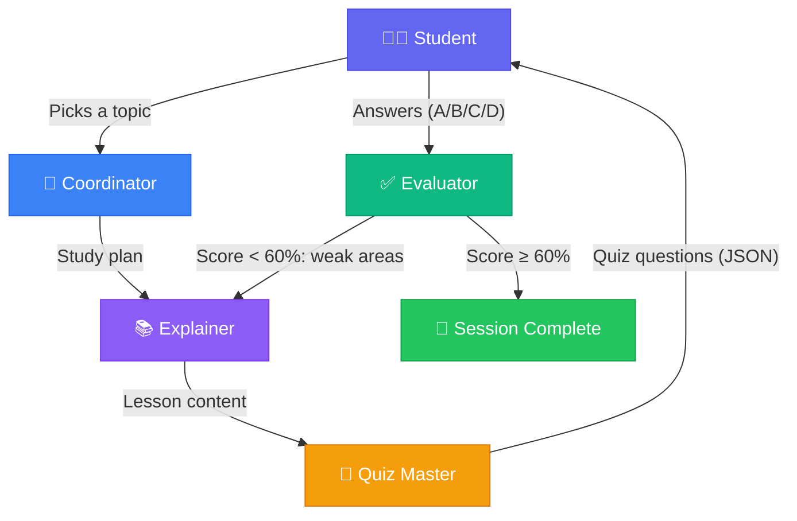

# 🦁 Leo — Multi-Agent AI Tutor

Leo is a **multi-agent AI tutoring system** built with [CrewAI](https://crewai.com) and [Gradio](https://gradio.app). Four specialized AI agents collaborate to deliver a complete learning experience: planning, teaching, quizzing, and evaluating — with a built-in feedback loop for re-teaching weak areas.

---

## 🏗️ Architecture

### Agent Roles

| Agent | Role | What It Does |
|-------|------|-------------|
| 🎯 **Coordinator** | Lead Coordinator & Study Planner | Analyses the student's topic, breaks it into sub-topics, and creates a structured study plan. Delegates to the other agents and manages error recovery. |
| 📚 **Explainer** | Concept Explainer & Teacher | Teaches each sub-topic with clear explanations, real-world analogies, and structured takeaways. Handles re-teaching when the Evaluator flags weak areas. |
| 🧩 **Quiz Master** | Quiz Master & Assessment Designer | Generates structured multiple-choice questions (4 per topic) that test genuine understanding. Uses Pydantic models for guaranteed JSON output. |
| ✅ **Evaluator** | Answer Evaluator & Feedback Specialist | Grades the student's quiz answers, provides per-question feedback, calculates scores, and identifies areas needing re-teaching. |

### Orchestration Pattern

**Sequential Process with Feedback Loop**

```
┌─────────────┐     ┌────────────┐     ┌──────────────┐     ┌─────────────┐
│ Coordinator │────▶│  Explainer │────▶│  Quiz Master │────▶│  Evaluator  │
│ (Plan)      │     │  (Teach)   │     │  (Quiz)      │     │  (Grade)    │
└─────────────┘     └────────────┘     └──────┬───────┘     └──────┬──────┘
                          ▲                   │                     │
                          │                   ▼                     │
                          │            ┌──────────────┐             │
                          │            │   Student    │             │
                          │            │  (Answers)   │             │
                          │            └──────────────┘             │
                          │                                         │
                          │         ┌───────────────────┐           │
                          └─────────│ Feedback Loop     │◀──────────┘
                                    │ (if score < 60%)  │
                                    └───────────────────┘
```

### How Handoffs Work

1. **Coordinator → Explainer**: The study plan output flows as context to the Explainer via CrewAI's sequential task chaining.
2. **Explainer → Quiz Master**: The lesson content becomes context for generating relevant quiz questions.
3. **Quiz Master → Student (Human-in-the-Loop)**: The UI presents questions and waits for the student to answer — real human interaction, not simulated.
4. **Student → Evaluator**: Student answers are packaged with the quiz JSON and sent to the Evaluator.
5. **Evaluator → Explainer (Feedback Loop)**: If the score is below 60%, the Evaluator's `weak_areas` list is routed back to the Explainer for focused re-teaching with new examples.

### Architecture Diagram



---

## 🚀 Getting Started

### Prerequisites

- Python 3.11+
- An OpenAI API key

### Installation

```bash
# 1. Clone the repository
git clone https://github.com/your-username/Leo-Multi-Agent-AI-Tutor.git
cd Leo-Multi-Agent-AI-Tutor

# 2. Create a virtual environment
python -m venv venv

# On Windows:
venv\Scripts\activate
# On macOS/Linux:
source venv/bin/activate

# 3. Install dependencies
pip install -r requirements.txt

# 4. Set up your API key
copy .env.example .env
# Edit .env and add your real OPENAI_API_KEY
```

### Running the App

```bash
python app.py
```

Then open **http://localhost:7860** in your browser.

### Configuration

Edit `.env` to customize:

```env
OPENAI_API_KEY=sk-your-key-here
OPENAI_MODEL_NAME=gpt-4o-mini   # or gpt-4o for better quality
```

---

## 📖 How to Use

1. **Enter your name** and the **topic** you want to learn (e.g., "Photosynthesis")
2. Click **🚀 Start Learning** — watch the Agent Activity panel as the Coordinator plans and the Explainer teaches
3. Read the lesson, then scroll to the **Quiz** section
4. **Answer all 4 questions** (A, B, C, or D) and click **📤 Submit Answers**
5. Review your **Evaluation Results** with per-question feedback
6. If you scored below 60%, Leo automatically re-teaches the weak areas and gives you a new quiz!

---

## 🛠️ Project Structure

```
Leo-Multi-Agent-AI-Tutor/
├── app.py                  # Gradio UI entry point
├── requirements.txt        # Python dependencies
├── .env.example            # API key template
├── .gitignore
├── README.md
└── leo/                    # Core package
    ├── __init__.py
    ├── agents.py           # Agent factory functions (4 agents)
    ├── crew.py             # CrewAI orchestration engine
    ├── prompts.py          # Prompt templates per agent role
    ├── schemas.py          # Pydantic models for structured output
    └── tasks.py            # Task definitions with handoff logic
```

---

## ✨ Key Features

| Feature | Implementation |
|---------|---------------|
| **Multi-agent orchestration** | CrewAI with sequential process |
| **Real handoffs** | Task context chaining — each agent's output feeds the next |
| **Structured output** | Pydantic models (`QuizOutput`, `EvaluationOutput`) via `output_pydantic` |
| **Memory** | CrewAI memory enabled for context retention across tasks |
| **Prompt templates** | Dedicated prompts per role in `prompts.py` |
| **Human-in-the-loop** | Student answers quiz before evaluation proceeds |
| **Feedback loop** | Evaluator routes weak areas back to Explainer for re-teaching |
| **Error handling** | Graceful JSON parsing fallbacks, max re-teach limit (2 rounds) |
| **Live activity feed** | Real-time agent status display in the UI |

---

## 📜 License

MIT License — see [LICENSE](LICENSE) for details.
